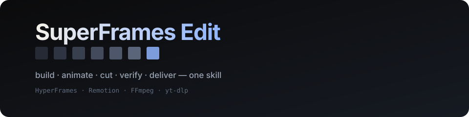

<p align="center">
  
</p>

<p align="center"><b>One skill. The whole AI video pipeline.</b></p>

<p align="center">
  <a href="LICENSE"></a>
  
  
  
</p>

<p align="center">
  <a href="#install">Install</a> ·
  <a href="#what-is-in-here">Skills</a> ·
  <a href="#the-pipeline">Pipeline</a> ·
  <a href="#why-combine">Why combine</a> ·
  <a href="#verification">Verification</a> ·
  <a href="THIRD_PARTY_NOTICES.md">Provenance</a>
</p>

---

SuperFrames Edit merges the four tools people actually use to make AI video — **HyperFrames**
(HTML to video), **Remotion** (React to video), **FFmpeg** (cuts and exports) and **yt-dlp**
(references) — into a single agent skill with one contract, one pipeline and one verification gate.

The point is not to bundle four tools. It is that each one's known failure is covered by another's
strength, and an agent that holds all four can finish the job instead of stopping to ask you to call
the next repo.

## Install

Pick one route per agent. Every route installs the same skills.

### Claude Code

```bash
claude plugin marketplace add jamescai-md/superframes-edit
claude plugin install superframes-edit@superframes-edit
```

Then start a session and ask for a video. Skills are namespaced, e.g. `/superframes-edit:superframes-edit`.

### Codex / OpenCode / any agent with `skills` CLI

```bash
npx skills add jamescai-md/superframes-edit
```

Or copy `skills/` into your project — `skills/superframes-edit` is the entry point.

### Gemini CLI

```bash
gemini extensions install https://github.com/jamescai-md/superframes-edit
```

### Cursor / VS Code

Add `jamescai-md/superframes-edit` as a plugin marketplace, or copy the repo's `skills/` into
`.cursor/skills/` or your agent's skills directory. The `.cursor-plugin/`, `.codex-plugin/` and
`gemini-extension.json` manifests are already in place.

### Hermes, and anything else

Point the agent at `skills/superframes-edit/SKILL.md`. That file is the router; it names every
stage and the file to read for it. Nothing else is needed to start.

### Requirements

| Track | Needs |
| --- | --- |
| Build — HTML | Node 22+, `npx hyperframes` supplies the renderer |
| Build — React | Node 22+, `npx create-video` |
| Cut, mix, export, verify | `ffmpeg` + `ffprobe` (`brew install ffmpeg`, `apt install ffmpeg`, `winget install Gyan.FFmpeg`) |
| References | `yt-dlp` (`pip install -U yt-dlp`) |
| Optional | A HeyGen sign-in for catalog music, assets and voice; a local Chrome for rendering |

Check the machine before a job:

```bash
bash skills/superframes-edit/scripts/superframes/doctor.sh
```

It prints one line per capability with the fix for each gap, and exits non-zero if a required
track is missing.

## What is in here

The **published** skills are the four SuperFrames skills plus the HyperFrames set they coordinate.
Everything is installed together, so nothing has to be fetched mid-job.

| Skill | Job |
| --- | --- |
| [`superframes-edit`](skills/superframes-edit/SKILL.md) | **Read first.** The contract, the seven stages, routing, failure playbook. |
| [`superframes-build`](skills/superframes-build/SKILL.md) | Build as code: HyperFrames (HTML) or Remotion (React), with the Remotion corpus vendored inside. |
| [`superframes-cut`](skills/superframes-cut/SKILL.md) | FFmpeg stage: trim, concat, mix, normalise, speed, captions, delivery encodes. |
| [`superframes-acquire`](skills/superframes-acquire/SKILL.md) | yt-dlp downloads, access walls, provenance ledger, reference analysis. |
| [`hyperframes`](skills/hyperframes/SKILL.md) | The HyperFrames authoring contract, format, motion, look, captions, film and story references. |
| [`hyperframes-cli`](skills/hyperframes-cli/SKILL.md) | The CLI by job: scaffold, check, snapshot, timeline edits, preview, render, recover. |
| [`hyperframes-registry`](skills/hyperframes-registry/SKILL.md) | ~450 ready-made blocks and components, installed as editable source. |
| [`media-use`](skills/media-use/SKILL.md) | Music, SFX, images, logos, voice, avatars, transcripts, grades, audio mixing. |
| [`slideshow`](skills/slideshow/SKILL.md) | A navigable deck, not an MP4. |
| [`remotion-to-hyperframes`](skills/remotion-to-hyperframes/SKILL.md) | Migrate Remotion (or Motion Canvas, Lottie, Three.js) into HTML, verified frame by frame. |
| [`reverse-any-video`](skills/reverse-any-video/SKILL.md) | Rebuild any video file as an editable project, checked against the original. |
| [`style-sampling`](skills/style-sampling/SKILL.md) | New episodes in one of five proven styles. |
| [`figma`](skills/figma/SKILL.md) | Bring Figma assets, tokens and storyboard frames into a film. |

Supporting material:

| Path | What |
| --- | --- |
| `skills/superframes-edit/references/` | The seven stage references: brief, acquire, analyze, build, motion, cut-export, verify, deliver, method. |
| `skills/superframes-edit/scripts/superframes/` | `doctor.sh`, `verify.sh` — the two scripts every job needs. |
| `skills/superframes-cut/scripts/superframes/cut.sh` | Every FFmpeg operation in this repo, tested, one subcommand each. |
| `skills/superframes-acquire/scripts/superframes/` | `analyze.sh` (reference to numbers), `provenance.sh` (asset licence ledger). |
| `skills/superframes-build/references/remotion/` | The Remotion skill corpus, vendored. |
| `packages/`, `registry/` | The HyperFrames renderer source and the block registry. |
| `examples/` | Complete working films. |

## The pipeline

```text
 0 Intake    →  SPEC.md: duration, fps, dimensions, shots, adjectives as numbers
 1 Acquire   →  assets/ + PROVENANCE.tsv: URL, licence class, credit
 2 Analyse   →  ANALYSIS.md: shot table, palette, motion numbers, loudness
 3 Build     →  a project that renders: HyperFrames HTML or Remotion React
 4 Motion    →  every move has a cause, a curve and a duration
 5 Cut/mix   →  assemble, duck, normalise once, tag colour
 6 Verify    →  verify.sh: duration, frames, loudness, peaks, sync, SSIM
 7 Deliver   →  master + web + social, DELIVERY.md, checksums
```

Each stage has an exit condition. You do not leave a stage until it is met, which is what stops the
classic loop where a wrong reference poisons the build, the build poisons the cut, and the cut
poisons the export.

## Why combine

Every one of these tools has a gap that only the others close. This is the actual engineering
argument for the repo, not marketing:

| Gap | Alone | Covered here by |
| --- | --- | --- |
| No footage editing | HyperFrames and Remotion compose; neither cuts a long recording | `superframes-cut` — segments, concat, J/L cuts |
| No visual assets or music | HyperFrames ships none | `media-use` — catalog music, assets, voice, grades |
| No licence discipline | yt-dlp downloads anything | `provenance.sh` — a licence class blocks delivery |
| No loudness discipline | Neither engine normalises | two-pass EBU R128 at a stated target |
| No A/V sync proof | Both assume sync | `verify.sh --audio` measures stream offsets |
| No frame verification | A render can "succeed" and look wrong | frames + SSIM/PSNR against a reference |
| Silent font fallbacks | Both render whatever font resolves | font audit stage + bundled faces |
| Remotion licence scope | Paid company licence above the free threshold | HyperFrames track, or buy it and disclose |
| Heavy render footprint | Remotion needs Chrome plus a bundle per render | HyperFrames render, or a prebuilt warm Studio |
| Container and colour handling | Left to the caller | explicit, tagged delivery presets |

## Verification

Nothing here is delivered on a claim. The gate is one command:

```bash
bash skills/superframes-edit/scripts/superframes/verify.sh out/master.mp4 \
  --expect-duration 18 --expect-size 1920x1080 --expect-fps 30 \
  --audio --black --freeze --frames out/verify
```

```text
PASS  file                   41.03 MB mov,mp4,m4a
PASS  video-stream           h264 1920x1080 30.000 fps yuv420p
PASS  duration               18.000s (expected 18s)
PASS  frame-count            540 frames ≈ 540 expected
PASS  colour-tags            bt709/tv
PASS  loudness               -14.20 LUFS (target -14)
PASS  true-peak              -1.60 dBTP (ceiling -1.0)
PASS  av-sync-start          within one frame (0.0000s)
```

`FAIL` blocks delivery. `WARN` is allowed but must be named in `DELIVERY.md`.

Two other checks worth knowing:

```bash
bash skills/superframes-acquire/scripts/superframes/provenance.sh check   # every asset licensed
node scripts/superframes-verify/verify-skills.mjs                        # this repo's own gate
```

## Use it as an agent scratchpad too

The repo ships the [agent skills](THIRD_PARTY_NOTICES.md#agent-method-skills) this project itself
was built with — planning, doubt-driven development, review, simplification — in
`skills/../references/method.md`. That is why `superframes-edit/references/method.md` exists: the
discipline is part of the deliverable.

## Contributing

Read [`AGENTS.md`](AGENTS.md) and [`CONTRIBUTING.md`](CONTRIBUTING.md). The one non-negotiable:
run the repo's own gate before a pull request.

```bash
node scripts/superframes-verify/verify-skills.mjs
node scripts/superframes-verify/check-clean.mjs
```

## Licence and provenance

Apache-2.0, inherited from the HyperFrames fork this repository is built on. Every merged upstream
is credited with its licence in [`THIRD_PARTY_NOTICES.md`](THIRD_PARTY_NOTICES.md). HyperFrames,
Remotion, FFmpeg and yt-dlp are independent projects; this repo is not affiliated with or endorsed
by any of them.
